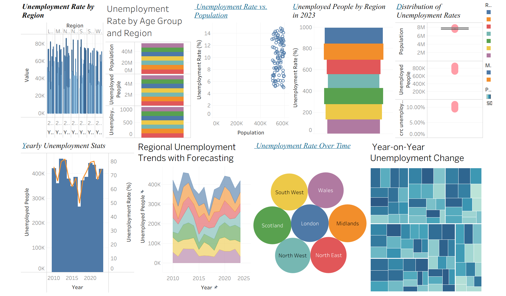

# Regional Unemployment Trends in the UK (2010–2023)

An exploratory data visualisation project built in **Tableau**, produced for the *Data Visualisation and Exploratory Analytics* module of my MSc in Data Analytics.

> **Research question:** *How has unemployment varied by region in the UK from 2010 to 2023?*



## Overview

Unemployment shapes economic performance for individuals, regions and the country as a whole. This project maps how unemployment shifted across seven UK regions over 14 years, to highlight structural regional differences and the effect of economic shocks such as the COVID-19 pandemic.

The work covers the full workflow: cleaning and preparing the data in Excel, choosing suitable chart types for each variable, and building an interactive Tableau dashboard.

## Dataset

| Column | Type | Description |
|---|---|---|
| `Year` | Quantitative (time) | 2010–2023 |
| `Region` | Qualitative | London, Midlands, North East, North West, Scotland, South West, Wales |
| `Population` | Quantitative | Population of the region |
| `Unemployment Rate (%)` | Quantitative | Regional unemployment rate |
| `Unemployed People` | Quantitative | Number of unemployed people |

- **Rows:** 98 (7 regions × 14 years)
- **Source:** UK Office for National Statistics (ONS)

### Data preparation (Excel)
- Removed duplicate rows and rows with missing values
- Standardised region names so they match consistently
- Formatted years as a numeric time series
- Checked that all unemployment rates were expressed as percentages
- Renamed columns to be clear and descriptive

## Visualisations

The dashboard brings together these Tableau sheets:

| Sheet | Purpose |
|---|---|
| Unemployment Rate by Region | Compare rates across regions |
| Unemployment Rate by Age Group and Region | Compare population, unemployed people and rate by region |
| Unemployment Rate vs. Population | Scatter plot of the relationship between population and unemployment |
| Unemployed People by Region in 2023 | Regional breakdown for the latest year |
| Distribution of Unemployment Rates | Box plots showing the spread of values |
| Yearly Unemployment Stats | Dual-axis bar and line chart of unemployed people and rate by year |
| Regional Unemployment Trends with Forecasting | Stacked area chart by region, with a Tableau forecast for 2024–2026 |
| Unemployment Rate Over Time | Packed bubble view by region |
| Year-on-Year Unemployment Change | Treemap of annual changes in rate |

### Regional Unemployment Trends with Forecasting


### Yearly Unemployment Stats


## Key insights

- Unemployment peaked in **2012–2013** after the financial crisis, fell to its lowest point in **2017**, then rose sharply again in **2020** during the pandemic.
- There is **no strong linear relationship** between a region's population and its unemployment rate.
- The regional mix of unemployed people changes noticeably from year to year, which suggests local labour markets are volatile.
- The year-on-year change view shows which regions and years saw the sharpest improvements or declines.

## Interactive features

- **Year filter:** view the data for any chosen year
- **Region dropdown:** focus on a single region
- **Tooltips:** hover over any data point to see its details

## Repository structure

```
uk-unemployment-trends/
├── data/
│   └── data-uk-unemployment-trends.xlsx   # Cleaned dataset
├── images/
│   ├── dashboard.png                      # Full dashboard screenshot
│   ├── Regional unemployment trends.png
│   └── Yearly unemployment stats.png
├── tableau/
│   └── DV_Final.twbx                      # Packaged Tableau workbook
└── README.md
```

## How to open the project

1. Install [Tableau Desktop](https://www.tableau.com/products/desktop) or the free [Tableau Reader](https://www.tableau.com/products/reader).
2. Download or clone this repository.
3. Open `tableau/DV_Final.twbx`. It is a packaged workbook, so the data is already included.

## Tools

- **Tableau:** visual analytics, dashboard and forecasting
- **Microsoft Excel:** data cleaning and preparation

## Limitations

- Regional averages hide variation within each region.
- Single-year views do not show change over time unless the filters are used.
- Scatter plots can be distorted by outliers and scale choices.
- Forecasts are statistical projections based only on 2010–2023 data.

## Author

**Muhammed Hashim Pullot**, MSc Data Analytics
